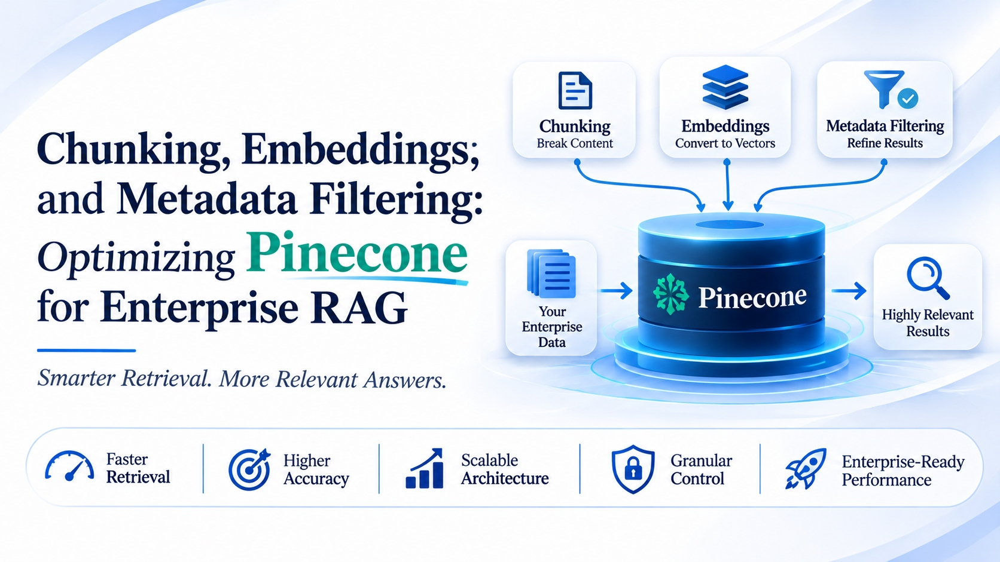

# Chunking, Embeddings, and Metadata Filtering: Optimizing Pinecone for Enterprise RAG



When an enterprise RAG system gives a poor answer, the language model usually gets the blame. In most cases the real cause sits earlier, in how documents were split, how they were embedded, and whether the right filters narrowed the search. Get those three right, and the model has far better material to work with.

Teams building at scale often treat the whole path from ingestion to answer as one system, which is where [Pinecone and LangChain RAG orchestration](https://zignuts.com/ai-services/ai-integration/pinecone-integration-services?utm_source=seo_web2.0&utm_medium=backlink&utm_campaign=seo_referral&utm_id=11) comes in: the index stores and searches vectors, and the orchestration layer controls how documents are split, embedded, filtered, and passed to the model.

## The Three Levers

| Lever | Main question | Common mistake |
|---|---|---|
| **Chunking** | How should documents be split? | Fixed-size cuts that slice tables and sections in half |
| **Embeddings** | What counts as similar? | Mixing models between indexing and querying |
| **Metadata filtering** | What should the search be allowed to see? | Checking permissions after retrieval instead of during it |

## Chunking Checklist

- [ ] Split on headings, paragraphs, and list items before using a fixed size
- [ ] Use modest overlap so boundary-crossing ideas survive
- [ ] Keep tables and code blocks whole
- [ ] Prepend document title and section heading to each chunk
- [ ] Compare a few chunk sizes on a fixed test set

## Embedding Rules

1. **Match the model to the domain** and test it on your own questions.
2. **Use the same model for indexing and querying.**
3. **Match the index** dimension and distance metric to the model.
4. **Version your embeddings** by storing the model name in metadata.
5. **Plan for re-embedding** by keeping source text and a repeatable pipeline.
6. **Consider hybrid search** when exact terms such as part numbers matter.

## Metadata Filter Example

```
query:
  vector:     [ ...embedding of the question... ]
  top_k:      8
  namespace:  "acme-corp"
  filter:
    doc_type:     { "$in": ["policy", "contract"] }
    access_level: { "$lte": 2 }
    year:         { "$gte": 2024 }
```

## Useful Metadata Fields

| Field | Why it helps |
|---|---|
| tenant or business unit | Keeps one customer's data out of another's results |
| access level or role | Enforces permissions during retrieval |
| document type | Lets a query target policies, contracts, or manuals |
| date or version | Prefers current content |
| source and document id | Supports citations, updates, and deletes |
| embedding model version | Tracks which vectors need re-embedding |

Keep metadata lean. Size limits apply, so confirm current limits in the Pinecone documentation.

## Measure Retrieval Quality

| Measure | What it tells you |
|---|---|
| Recall at k | Whether the right passage appears in the top results |
| Precision at k | How much of the retrieved text is relevant |
| Rank of first hit | How early the useful passage arrives |
| Filter correctness | Whether restricted content ever leaks into results |
| Latency and cost | Whether quality gains are affordable at scale |

## Operating the Index

- [ ] Vector ids derived from document id and chunk position
- [ ] Old chunks removed before new ones are inserted
- [ ] Writes batched with safe retries
- [ ] Freshness tracked from upload to searchable
- [ ] Golden set re-run on a schedule to catch drift

## Get Started

Ready to build retrieval you can trust? Visit [zignuts.com](https://zignuts.com/) to speak with the team.

`pinecone` `enterprise-rag` `chunking` `embeddings` `metadata-filtering` `vector-database` `langchain`
